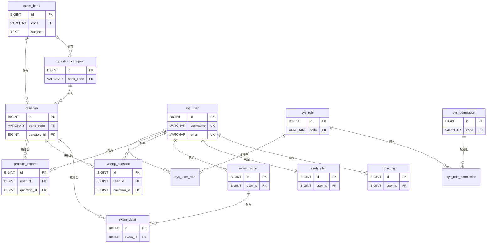

# 研题通·考研408刷题训练系统 数据库设计文档

## 1. 概述

本系统数据库名为 `ytt_db`，采用 MySQL InnoDB 存储引擎，字符集统一为 `utf8mb4`（完整支持 emoji 及生僻汉字），排序规则使用 utf8mb4 默认规则。全库共 **14 张表**，覆盖用户权限（RBAC）、题库大类、刷题训练、模拟考试、学习计划与登录审计六大业务域。

数据库结构采用 **Flyway 版本化迁移**管理，脚本位于 `ytt-server/src/main/resources/db/migration/`：

| 版本 | 脚本 | 内容 |
| --- | --- | --- |
| V1 | `V1__init.sql` | 创建 13 张表的完整 DDL |
| V2 | `V2__seed.sql` | 种子数据：内置角色 2 个、权限点 12 个、题目分类 23 个、首批原创题 41 道 |
| V3 | `V3__add_email.sql` | sys_user 新增 `email` 列（NOT NULL，唯一约束 uk_sys_user_email），并按 `{username}@yantitong.local` 回填存量账号 |
| V4 | `V4__exam_bank_expand.sql` | 新增 `exam_bank` 题库大类表；question/question_category 新增 `bank_code` 归属列；修正 practice_record.mode 默认值（normal→sequence）；新增 79 道自研题目，考研408 题库达 120 题（四科各 30） |

DDL 设计遵循以下通用约定：

- 兼容 MySQL 5.7/8.x 与 H2 测试库（MODE=MySQL），不使用 MySQL 8.0 专属语法；
- 时间列统一 `DEFAULT CURRENT_TIMESTAMP`，不使用 `ON UPDATE` 自动更新（更新时间由应用层维护）；
- 核心业务表（sys_user、question）采用 `deleted` 字段逻辑删除、`version` 字段乐观锁；
- 所有表使用 `IF NOT EXISTS`，可重复执行、幂等建表。

## 2. 表关系总览

### 2.1 实体关系说明

| 关系 | 基数 | 说明 |
| --- | --- | --- |
| exam_bank → question | 1 : N | 题目通过 `bank_code` 归属题库大类（V4 新增） |
| exam_bank → question_category | 1 : N | 分类通过 `bank_code` 归属题库大类（V4 新增） |
| sys_user ↔ sys_role | N : N | 经关联表 `sys_user_role`（uk_user_role 唯一键防重复授权） |
| sys_role ↔ sys_permission | N : N | 经关联表 `sys_role_permission`（uk_role_permission 唯一键） |
| question → question_category | N : 1 | 题目通过 `category_id` 归属某一分类，分类可为空（且二者须同属一个 bank_code） |
| practice_record → sys_user | N : 1 | 每条刷题记录属于一个用户 |
| wrong_question → sys_user | N : 1 | 错题本按用户隔离，(user_id, question_id) 唯一 |
| exam_record → sys_user | N : 1 | 每场考试记录属于一个用户 |
| exam_detail → exam_record | N : 1 | 明细通过 `exam_id` 归属一次考试 |
| study_plan → sys_user | 1 : 1 | 每个用户仅一条学习计划（uk_study_plan_user 唯一键） |
| login_log → sys_user | N : 1 | 登录日志可关联用户（登录失败时 user_id 可为空） |

### 2.2 ER 图（Mermaid）

## 3. 逐表字段说明

### 3.1 sys_user（用户表）

| 字段 | 类型 | 是否空 | 默认值 | 含义 |
| --- | --- | --- | --- | --- |
| id | BIGINT | NOT NULL | AUTO_INCREMENT | 主键 |
| username | VARCHAR(64) | NOT NULL | — | 登录用户名 |
| email | VARCHAR(128) | NOT NULL | '' | 邮箱（验证码登录凭证，全表唯一） |
| password | VARCHAR(100) | NOT NULL | — | BCrypt 加密密码 |
| real_name | VARCHAR(64) | NULL | NULL | 真实姓名/昵称 |
| status | INT | NOT NULL | 1 | 状态：1启用 0禁用 |
| version | INT | NOT NULL | 0 | 乐观锁版本号 |
| create_time | DATETIME | NOT NULL | CURRENT_TIMESTAMP | 创建时间 |
| update_time | DATETIME | NOT NULL | CURRENT_TIMESTAMP | 更新时间 |
| deleted | INT | NOT NULL | 0 | 逻辑删除：0正常 1已删 |

- **主键**：id；**唯一索引**：uk_sys_user_username（username）、uk_sys_user_email（email）。
- **设计要点**：密码仅存 BCrypt 哈希，不落明文；username 与 email 均有唯一约束在数据库层兜底，防止重复注册（email 冲突返回 40905）；密码登录以 username 查询账号，验证码登录按 email 匹配（对应 `AuthService` 的 login 与 loginByEmail 两个入口）；version 配合 MyBatis-Plus `@Version` 实现乐观锁；deleted 配合 MyBatis-Plus 全局逻辑删除配置（logic-delete-field: deleted），查询自动过滤已删数据。

### 3.2 sys_role（角色表）

| 字段 | 类型 | 是否空 | 默认值 | 含义 |
| --- | --- | --- | --- | --- |
| id | BIGINT | NOT NULL | AUTO_INCREMENT | 主键 |
| code | VARCHAR(64) | NOT NULL | — | 角色编码（如 ADMIN/STUDENT） |
| name | VARCHAR(64) | NOT NULL | — | 角色名称 |

- **主键**：id；**唯一索引**：uk_sys_role_code（code）。
- **设计要点**：种子数据内置 ADMIN（系统管理员）、STUDENT（考研学员）两个角色，编码唯一。

### 3.3 sys_user_role（用户角色关联表）

| 字段 | 类型 | 是否空 | 默认值 | 含义 |
| --- | --- | --- | --- | --- |
| id | BIGINT | NOT NULL | AUTO_INCREMENT | 主键 |
| user_id | BIGINT | NOT NULL | — | 用户ID |
| role_id | BIGINT | NOT NULL | — | 角色ID |

- **主键**：id；**唯一索引**：uk_user_role（user_id, role_id）。
- **设计要点**：支撑用户与角色 N:N 关系，复合唯一键防止同一用户重复授予同一角色。

### 3.4 sys_permission（权限点表）

| 字段 | 类型 | 是否空 | 默认值 | 含义 |
| --- | --- | --- | --- | --- |
| id | BIGINT | NOT NULL | AUTO_INCREMENT | 主键 |
| code | VARCHAR(128) | NOT NULL | — | 权限编码 |
| name | VARCHAR(64) | NOT NULL | — | 权限名称 |
| type | VARCHAR(16) | NOT NULL | 'api' | 类型：menu菜单/api接口 |

- **主键**：id；**唯一索引**：uk_sys_permission_code（code）。
- **设计要点**：种子数据内置 12 个 api 类型权限点，覆盖用户管理（查询/新增/编辑/删除/启停/重置密码/分配角色）、题目管理（查询/新增/编辑/删除）与分类管理，供后端 `@PreAuthorize` 鉴权使用。

### 3.5 sys_role_permission（角色权限关联表）

| 字段 | 类型 | 是否空 | 默认值 | 含义 |
| --- | --- | --- | --- | --- |
| id | BIGINT | NOT NULL | AUTO_INCREMENT | 主键 |
| role_id | BIGINT | NOT NULL | — | 角色ID |
| permission_id | BIGINT | NOT NULL | — | 权限ID |

- **主键**：id；**唯一索引**：uk_role_permission（role_id, permission_id）。
- **设计要点**：支撑角色与权限 N:N 关系；种子数据中 ADMIN 角色被授予全部 12 个权限点。

### 3.6 question_category（题目分类表）

| 字段 | 类型 | 是否空 | 默认值 | 含义 |
| --- | --- | --- | --- | --- |
| id | BIGINT | NOT NULL | AUTO_INCREMENT | 主键 |
| bank_code | VARCHAR(32) | NOT NULL | 'ky408' | 所属题库编码（V4 新增，关联 exam_bank.code） |
| subject | VARCHAR(16) | NOT NULL | — | 科目：题库内科目编码（408 为 ds/co/os/cn） |
| name | VARCHAR(64) | NOT NULL | — | 分类名称 |
| sort | INT | NOT NULL | 0 | 排序号 |

- **主键**：id；**普通索引**：idx_category_bank（bank_code）、idx_category_subject（subject）。
- **设计要点**：科目编码的含义由所属题库的 subjects 定义决定——考研408 为 ds 数据结构、co 计算机组成原理、os 操作系统、cn 计算机网络；sort 控制同题库同科目内分类展示顺序。种子数据内置 23 个分类（ds 6 个、co 5 个、os 6 个、cn 6 个），按章节归集，V4 起全部归入 ky408。

### 3.7 question（题目表）

| 字段 | 类型 | 是否空 | 默认值 | 含义 |
| --- | --- | --- | --- | --- |
| id | BIGINT | NOT NULL | AUTO_INCREMENT | 主键 |
| bank_code | VARCHAR(32) | NOT NULL | 'ky408' | 所属题库编码（V4 新增，关联 exam_bank.code） |
| type | VARCHAR(16) | NOT NULL | — | 题型：single单选/multi多选/judge判断 |
| subject | VARCHAR(16) | NOT NULL | — | 科目：题库内科目编码（408 为 ds/co/os/cn） |
| category_id | BIGINT | NULL | NULL | 所属分类ID |
| chapter | VARCHAR(64) | NULL | NULL | 章节 |
| difficulty | INT | NOT NULL | 1 | 难度：1简单 2中等 3困难 |
| stem | TEXT | NOT NULL | — | 题干（支持富文本HTML） |
| options | TEXT | NOT NULL | — | 选项列表（JSON数组） |
| answer | TEXT | NOT NULL | — | 正确选项下标（JSON数组） |
| analysis | TEXT | NULL | NULL | 答案解析 |
| source | VARCHAR(64) | NULL | NULL | 来源 |
| create_by | BIGINT | NULL | NULL | 创建人 |
| version | INT | NOT NULL | 0 | 乐观锁版本号 |
| create_time | DATETIME | NOT NULL | CURRENT_TIMESTAMP | 创建时间 |
| update_time | DATETIME | NOT NULL | CURRENT_TIMESTAMP | 更新时间 |
| deleted | INT | NOT NULL | 0 | 逻辑删除：0正常 1已删 |

- **主键**：id；**普通索引**：idx_question_bank（bank_code）、idx_question_subject（subject）、idx_question_category（category_id）、idx_question_difficulty（difficulty）。
- **设计要点**：
  - `bank_code` 是题库隔离的核心字段：刷题抽题、模拟组卷、学习统计均先按题库过滤；新增题目时服务端强制校验题库已上线、科目属于该题库、分类与题目同属一个题库；
  - `options`/`answer` 使用 TEXT 存储 JSON 数组（如 `["A","B","C","D"]`、`[0,1]`），统一兼容单选、多选、判断三种题型，避免为不同题型拆表；
  - 题干支持富文本 HTML，TEXT 类型避免长度限制；
  - bank_code/subject/category/difficulty 索引覆盖题库切换与刷题筛选（按题库、科目、分类、难度）及随机抽题的高频查询条件；
  - version 乐观锁防止管理端并发编辑题目互相覆盖；deleted 逻辑删除保证已被刷题记录/考试明细引用的题目可安全"下线"而不破坏历史数据。

### 3.8 practice_record（刷题记录表）

| 字段 | 类型 | 是否空 | 默认值 | 含义 |
| --- | --- | --- | --- | --- |
| id | BIGINT | NOT NULL | AUTO_INCREMENT | 主键 |
| user_id | BIGINT | NOT NULL | — | 用户ID |
| question_id | BIGINT | NOT NULL | — | 题目ID |
| user_answer | TEXT | NULL | NULL | 用户作答（JSON数组） |
| correct | INT | NOT NULL | 0 | 是否正确：1对 0错 |
| mode | VARCHAR(16) | NULL | 'sequence' | 模式：sequence顺序/wrong错题/random随机（V4 修正默认值，原 normal 为笔误） |
| create_time | DATETIME | NOT NULL | CURRENT_TIMESTAMP | 作答时间 |

- **主键**：id；**普通索引**：idx_practice_user（user_id）、idx_practice_question（question_id）、idx_practice_create_time（create_time）。
- **设计要点**：仅记录作答历史，不冗余题目内容（与 question 表解耦，题目更新不影响历史记录）；create_time 索引支撑"每日刷题量/学习打卡统计"按时间范围聚合。

### 3.9 wrong_question（错题本表）

| 字段 | 类型 | 是否空 | 默认值 | 含义 |
| --- | --- | --- | --- | --- |
| id | BIGINT | NOT NULL | AUTO_INCREMENT | 主键 |
| user_id | BIGINT | NOT NULL | — | 用户ID |
| question_id | BIGINT | NOT NULL | — | 题目ID |
| wrong_count | INT | NOT NULL | 1 | 累计错误次数 |
| last_answer | TEXT | NULL | NULL | 最近一次作答（JSON数组） |
| mastered | INT | NOT NULL | 0 | 是否已掌握：1是 0否 |
| create_time | DATETIME | NOT NULL | CURRENT_TIMESTAMP | 创建时间 |
| update_time | DATETIME | NOT NULL | CURRENT_TIMESTAMP | 更新时间 |

- **主键**：id；**唯一索引**：uk_wrong_user_question（user_id, question_id）。
- **设计要点**：(user_id, question_id) 唯一键保证同一用户同一题只占一条错题记录——重复答错时在原记录上累加 wrong_count 并更新 last_answer，数据库层防重复，配合应用层 upsert 逻辑；mastered 标记支持"掌握后移出错题本"。

### 3.10 exam_record（模拟考试记录表）

| 字段 | 类型 | 是否空 | 默认值 | 含义 |
| --- | --- | --- | --- | --- |
| id | BIGINT | NOT NULL | AUTO_INCREMENT | 主键 |
| user_id | BIGINT | NOT NULL | — | 用户ID |
| total_count | INT | NOT NULL | — | 试卷题目数 |
| correct_count | INT | NOT NULL | — | 答对题数 |
| score | INT | NOT NULL | — | 得分 |
| duration_seconds | INT | NOT NULL | 0 | 考试用时（秒） |
| create_time | DATETIME | NOT NULL | CURRENT_TIMESTAMP | 交卷时间 |

- **主键**：id；**普通索引**：idx_exam_user（user_id）、idx_exam_create_time（create_time）。
- **设计要点**：考试结果在交卷时一次性落库（总分、答对数、用时冗余存储），查询历史成绩无需回表明细重算；create_time 语义为交卷时间。

### 3.11 exam_detail（考试答题明细表）

| 字段 | 类型 | 是否空 | 默认值 | 含义 |
| --- | --- | --- | --- | --- |
| id | BIGINT | NOT NULL | AUTO_INCREMENT | 主键 |
| exam_id | BIGINT | NOT NULL | — | 考试记录ID |
| question_id | BIGINT | NOT NULL | — | 题目ID |
| user_answer | TEXT | NULL | NULL | 用户作答（JSON数组） |
| correct | INT | NOT NULL | 0 | 是否正确：1对 0错 |

- **主键**：id；**普通索引**：idx_exam_detail_exam（exam_id）。
- **设计要点**：与 exam_record 构成"主-从"结构（N:1），一次考试的逐题作答快照；exam_id 索引支撑按考试查询整张试卷的作答明细与逐题回顾。

### 3.12 study_plan（学习计划表）

| 字段 | 类型 | 是否空 | 默认值 | 含义 |
| --- | --- | --- | --- | --- |
| id | BIGINT | NOT NULL | AUTO_INCREMENT | 主键 |
| user_id | BIGINT | NOT NULL | — | 用户ID |
| daily_target | INT | NOT NULL | 30 | 每日目标题数 |
| exam_date | DATE | NULL | NULL | 考研初试日期 |
| create_time | DATETIME | NOT NULL | CURRENT_TIMESTAMP | 创建时间 |
| update_time | DATETIME | NOT NULL | CURRENT_TIMESTAMP | 更新时间 |

- **主键**：id；**唯一索引**：uk_study_plan_user（user_id）。
- **设计要点**：user_id 唯一键保证一个用户仅一条计划（1:1 关系），前端"保存计划"天然为 upsert 语义；exam_date 用于首页展示考研倒计时。

### 3.13 login_log（登录日志表）

| 字段 | 类型 | 是否空 | 默认值 | 含义 |
| --- | --- | --- | --- | --- |
| id | BIGINT | NOT NULL | AUTO_INCREMENT | 主键 |
| user_id | BIGINT | NULL | NULL | 用户ID（登录失败时可能为空） |
| username | VARCHAR(64) | NOT NULL | — | 登录用户名 |
| ip | VARCHAR(64) | NULL | NULL | 客户端IP |
| success | INT | NOT NULL | 0 | 是否成功：1成功 0失败 |
| message | VARCHAR(255) | NULL | NULL | 结果说明 |
| create_time | DATETIME | NOT NULL | CURRENT_TIMESTAMP | 登录时间 |

- **主键**：id；**普通索引**：idx_login_log_user（user_id）、idx_login_log_create_time（create_time）。
- **设计要点**：登录失败时用户名可能不存在于 sys_user，故 user_id 允许为空、不建外键约束；记录 IP、成败与原因，支撑安全审计与暴力破解排查，与登录接口限流（每分钟 5 次）形成纵深防御。

### 3.14 exam_bank（题库大类表，V4 新增）

| 字段 | 类型 | 是否空 | 默认值 | 含义 |
| --- | --- | --- | --- | --- |
| id | BIGINT | NOT NULL | AUTO_INCREMENT | 主键 |
| code | VARCHAR(32) | NOT NULL | — | 题库编码（如 ky408），全表唯一 |
| name | VARCHAR(64) | NOT NULL | — | 题库显示名称 |
| subjects | TEXT | NOT NULL | — | 科目定义 JSON：`[{"code":"ds","name":"数据结构"},...]` |
| status | INT | NOT NULL | 1 | 状态：1已上线 0未上线（前端切换器只展示已上线） |
| sort | INT | NOT NULL | 0 | 排序号，越小越靠前 |
| create_time | DATETIME | NOT NULL | CURRENT_TIMESTAMP | 创建时间 |

- **主键**：id；**唯一索引**：uk_exam_bank_code（code）。
- **设计要点**：
  - 题库大类体系的主数据表，与 question/question_category 为 1:N 逻辑关联（经 bank_code，不加物理外键）；
  - subjects 用 JSON 定义该题库包含的科目，刷题/统计接口按此动态返回科目维度——新增考试大类只需插入一行并导入题目，**无需改动业务代码与前端科目硬编码**（前端通过 `/common/banks` 获取科目列表）；
  - 首条种子数据为 id=1、code=`ky408`、name=「考研408·计算机学科专业基础」、科目 ds/co/os/cn、status=1；
  - 应用层用自定义 `SubjectListTypeHandler`（TypeReference 保留泛型）将 subjects 映射为 `List<ExamBank.Subject>`。

## 4. 种子数据说明

### 4.1 V2__seed.sql 基础数据

| 数据类别 | 数量 | 内容概要 |
| --- | --- | --- |
| 角色 | 2 | ADMIN（系统管理员）、STUDENT（考研学员） |
| 权限点 | 12 | 用户管理 7 个 + 题目管理 4 个 + 分类管理 1 个，全部为 api 类型 |
| 角色-权限 | 12 条 | ADMIN 角色拥有全部权限点 |
| 题目分类 | 23 | 数据结构 6、组成原理 5、操作系统 6、计算机网络 6，按章节归集 |
| 首批题目 | 41 | 覆盖四科三种题型（单选/多选/判断），难度 1–3 分布，options/answer 以 JSON 数组存储 |

### 4.2 V4__exam_bank_expand.sql 题库扩容

| 数据类别 | 数量 | 内容概要 |
| --- | --- | --- |
| 题库大类 | 1 | ky408「考研408·计算机学科专业基础」，含 4 个科目定义，状态已上线 |
| 新增题目 | 79（id 42–120，source 标注「V4扩充题库」） | ds 新增 19、co 20、os 20、cn 20；新增题目难度 易 23 / 中 37 / 难 19 |
| 题库总量 | **120** | 扩容后四科各 30 题（库存题量；模拟考试单次组卷数量仍由用户在 5–100 之间选择） |

---

## 编制说明

库表结构以 `db/migration` 下的 Flyway 脚本为准，本文是它们的「人话版」：表与字段的业务含义、索引和约束的来龙去脉都在这里。设计变更一律走新的迁移脚本而不是回头改历史脚本，所以文档里的历史包袱（如 V3 的 email 回填、V4 的题库归并）我也保留了下来，便于理解数据是怎么演进到当前形状的。
